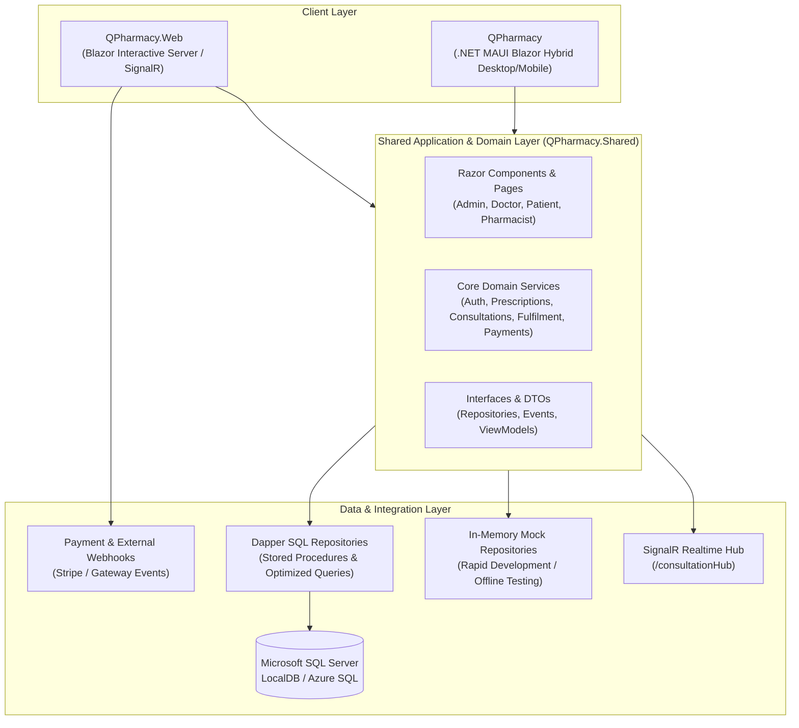

# QPharmacy

[](https://dotnet.microsoft.com/)
[](https://dotnet.microsoft.com/apps/maui)
[](https://dotnet.microsoft.com/apps/aspnet/web-apps/blazor)
[](https://www.microsoft.com/sql-server)
[](https://dotnet.microsoft.com/apps/aspnet/signalr)
[](https://tailwindcss.com/)

**QPharmacy** is an enterprise-grade digital pharmacy and teleconsultation platform built on a modern Microsoft .NET 9 unified architecture. It integrates a cross-platform desktop/mobile client (.NET MAUI Blazor Hybrid) and a web portal (Blazor Interactive Server) around a shared business core, connecting patients, doctors, pharmacists, and system administrators into an end-to-end healthcare workflow.

---

## 📑 Table of Contents

- [Architectural Overview](#-architectural-overview)
- [System Architecture & Roles](#-system-architecture--roles)
- [Project Structure](#-project-structure)
- [Core Workflows](#-core-workflows)
- [Technology Stack](#-technology-stack)
- [Prerequisites](#-prerequisites)
- [Getting Started & Local Setup](#-getting-started--local-setup)
- [Database Setup](#-database-setup)
- [Configuration & Environment](#-configuration--environment)
- [Security, Auth & Compliance](#-security-auth--compliance)
- [Roadmap & Contributing](#-roadmap--contributing)

---

## 🏛 Architectural Overview

QPharmacy utilizes a **Clean Architecture with Code-Sharing via Razor Class Libraries (RCL)**. UI components, views, models, and business logic are developed once in `QPharmacy.Shared` and deployed seamlessly across both web and native desktop runtimes.



---

## 👥 System Architecture & Roles

The platform implements role-based access control (RBAC) across four primary healthcare stakeholders:

| Role | Key Capabilities |
| :--- | :--- |
| **Patient** | Profile & medical history tracking, live teleconsultation requests, e-prescription tracking, payment processing, medication order history. |
| **Doctor** | Consultation queue management, real-time video/chat consultations, medical record review, digital e-prescription authoring and signing. |
| **Pharmacist** | Prescription verification queue, batch dispensing, inventory allocation, barcode/fulfillment tracking, fulfillment status overrides. |
| **Administrator** | User and tenant management, staff onboarding, audit log monitoring, biometric device registration, platform performance metrics. |

---

## 📂 Project Structure

```plaintext
d:\Dev\Eppetech\QPharmacy\
├── QPharmacy\                 # .NET MAUI Blazor Hybrid Native App (Windows, Android, iOS, macOS)
│   ├── Platforms/             # Native platform-specific configurations
│   ├── Resources/             # App icons, splash screens, fonts
│   ├── MauiProgram.cs         # MAUI dependency injection, Blazor WebView wiring
│   └── App.xaml               # Application root and window lifecycle
│
├── QPharmacy.Web\             # ASP.NET Core 9 Blazor Interactive Server Application
│   ├── Hubs/                  # Real-time SignalR Hubs (ConsultationHub)
│   ├── Services/              # Web-specific providers (IClientInfoProvider, context helpers)
│   ├── Program.cs             # Web host pipeline, webhook endpoints, middleware configuration
│   └── appsettings.json       # App configuration and connection strings
│
├── QPharmacy.Shared\          # Razor Class Library (RCL) - Shared UI, Logic & Infrastructure
│   ├── Layout/                # Reusable layouts, AppHeader, NavMenu, AppSidebar
│   ├── Models/                # Domain models, database entities, request/response DTOs
│   ├── Pages/                 # Shared Blazor views divided by role (Admin, Doctor, Patient, Pharmacist)
│   └── Services/              # Business interfaces and repository implementations (Dapper & Mock)
│
├── db data\                   # Database initialization scripts and stored procedures
│   ├── RunThisInSSMS.sql      # Master database setup script (tables + seed + procedures)
│   ├── Tables.sql             # Relational schema definitions
│   └── sp_*.sql               # Granular stored procedures (Auth, OTP, Consultations, Workflow)
│
├── tailwind.css               # Tailwind CSS v4 source styles and theme definitions
├── package.json               # Node.js dependencies for Tailwind CLI compilation
└── QPharmacy.sln              # Visual Studio solution manifest
```

---

## 🔄 Core Workflows

### 1. Unified Authentication & MFA
- Support for Password-based authentication with TOTP / SMS-based OTP verification.
- Biometric credential registration and device token validation (`sp_RegisterBiometricDevice`, `sp_ValidateBiometricDevice`).
- JWT token generation with client claims preservation across MAUI and Web.

### 2. Digital Teleconsultation Workflow
- Real-time patient-doctor room matching coordinated via SignalR (`/consultationHub`).
- Consultation life-cycle management: `Requested` $\rightarrow$ `In-Progress` $\rightarrow$ `Completed` $\rightarrow$ `Prescription Issued`.

### 3. Prescription & Dispensing Pipeline
- Doctor issues and signs electronic prescription with medication schedules and dosage details.
- Pharmacist verification queue (`VerifyPrescription` policy check).
- Dispense validation with stock decrement and fulfillment tracking (`DispenseMedication` policy check).

### 4. Resilient Payment & Webhook Integration
- Multi-channel checkout handling payment gateway intents.
- Cryptographically verified webhooks (`/api/webhooks/payment`) with idempotent event processing via `X-Event-Id` and `X-Signature`.

---

## 🛠 Technology Stack

- **Framework**: [.NET 9 (C# 13)](https://learn.microsoft.com/dotnet/)
- **UI & Presentation**:
  - Blazor Interactive Server (Web Portal)
  - .NET MAUI Blazor Hybrid (Cross-platform Desktop & Mobile)
  - Razor Class Libraries (Code sharing)
- **Real-Time Communication**: Microsoft ASP.NET Core SignalR
- **Data Access & Persistence**:
  - [Dapper](https://github.com/DapperLib/Dapper) (High-performance micro-ORM)
  - Microsoft SQL Server / LocalDB
  - Stored Procedures for strict data encapsulation and transaction atomicity
- **Authentication & Security**:
  - ASP.NET Core Identity & JWT Bearer Tokens
  - Policy-based Role Authorization (RBAC)
  - Biometric device attestation
- **Styling & Assets**:
  - Tailwind CSS v4 (`@tailwindcss/cli`)
  - SVG iconography and responsive flex/grid layouts

---

## ⚡ Prerequisites

Ensure you have the following installed on your developer machine:

1. **[.NET 9.0 SDK](https://dotnet.microsoft.com/download/dotnet/9.0)** (v9.0.100 or newer)
2. **Visual Studio 2022 (v17.12+)** or **VS Code with C# Dev Kit**
   - Workloads: *.NET MAUI development* and *ASP.NET and web development*
3. **[Microsoft SQL Server](https://www.microsoft.com/sql-server)** or **SQL Server LocalDB**
4. **[Node.js](https://nodejs.org/)** (v18+) and **[pnpm](https://pnpm.io/)** (for compiling Tailwind CSS assets)

---

## 🚀 Getting Started & Local Setup

### 1. Clone & Restore

```bash
git clone https://github.com/Muh-Khalil/QPharmacy.git
cd QPharmacy

# Restore .NET dependencies
dotnet restore QPharmacy.sln

# Install frontend asset dependencies
pnpm install
```

### 2. Build Tailwind CSS (Optional / UI Updates)

If you modify Tailwind styling or utility classes:

```bash
# Build Tailwind styles
npx @tailwindcss/cli -i ./tailwind.css -o ./QPharmacy.Shared/wwwroot/css/app.css --minify
```

### 3. Run the Web Application

```bash
dotnet run --project QPharmacy.Web/QPharmacy.Web.csproj
```
The application will launch on `https://localhost:7001` or `http://localhost:5000`.

### 4. Run the MAUI Hybrid Application (Desktop / Windows)

```bash
dotnet run --project QPharmacy/QPharmacy.csproj -f net9.0-windows10.0.19041.0
```

---

## 🗄 Database Setup

The application supports both live SQL Server databases and an **in-memory mock mode** for zero-dependency development.

### Option A: SQL Server LocalDB Setup (Recommended for Full Testing)
1. Open SQL Server Management Studio (SSMS) or Azure Data Studio.
2. Connect to `(localdb)\MSSQLLocalDB` or your local SQL Server instance.
3. Open and execute the master setup script:
   ```plaintext
   db data\RunThisInSSMS.sql
   ```
4. Verify the connection string in `QPharmacy.Web/appsettings.json`:
   ```json
   "ConnectionStrings": {
     "DefaultConnection": "Server=(localdb)\\MSSQLLocalDB;Database=QPharmacy;Trusted_Connection=True;TrustServerCertificate=True;"
   }
   ```

### Option B: Zero-Dependency Mock Mode
To run without a local SQL Server instance:
1. Open `QPharmacy.Web/appsettings.json` (or `MauiProgram.cs` for MAUI).
2. Set `"UseMockDatabase": true`.
3. The dependency injection container will automatically swap Dapper repositories for in-memory mock repositories (`MockAuthRepository`, `MockPrescriptionWorkflowRepository`, etc.).

---

## ⚙ Configuration & Environment

Key configuration variables located in `appsettings.json`:

```json
{
  "UseMockDatabase": false,
  "ConnectionStrings": {
    "DefaultConnection": "Server=(localdb)\\MSSQLLocalDB;Database=QPharmacy;Trusted_Connection=True;TrustServerCertificate=True;"
  },
  "Jwt": {
    "Key": "Your-Super-Secret-Key-At-Least-32-Characters-Long-For-JWT",
    "Issuer": "QPharmacy",
    "Audience": "QPharmacyUsers"
  },
  "SmsSettings": {
    "Provider": "Twilio",
    "AccountSid": "<YOUR_TWILIO_SID>",
    "AuthToken": "<YOUR_TWILIO_TOKEN>",
    "FromNumber": "<YOUR_TWILIO_PHONE>"
  }
}
```

> **Warning**: Never commit production connection strings, Twilio authentication tokens, or JWT signing secrets to version control. Use `.NET Secret Manager` (`dotnet user-secrets`) or environment variables for production environments.

---

## 🔒 Security, Auth & Compliance

- **Role Authorization Policies**: Handled via `builder.Services.AddAuthorizationCore(...)` enforcing strict claim rules (`ViewOwnPatientData`, `IssuePrescription`, `VerifyPrescription`, `DispenseMedication`, `ManageUsers`, `ViewAuditLogs`).
- **Data Protection**: All SQL operations parameterized through Dapper or stored procedures to mitigate SQL injection vulnerabilities.
- **Audit Logging**: Comprehensive activity tracking using dedicated database triggers and audit repositories for regulatory compliance.
- **Webhook Integrity**: Cryptographic header verification (`X-Signature`) preventing replay and spoofing attacks.

---

## 🤝 Roadmap & Contributing

1. **Phase 1-4**: Core RBAC, Prescription engine, and Store fulfillment *(Completed)*
2. **Phase 5**: Real-time consultation orchestration with WebRTC / SignalR *(Completed)*
3. **Phase 6**: Stripe Payment Intent & Webhook integration *(In Progress)*
4. **Phase 7**: Automated CI/CD pipelines (GitHub Actions) & Docker containerization *(Planned)*

### Contributing Guidelines
1. Fork the repository and create a descriptive branch: `feature/your-feature-name` or `bugfix/issue-description`.
2. Ensure all C# and Razor formatting complies with project conventions.
3. Test your changes against both **Mock** and **SQL Server** repository implementations before submitting a PR.
